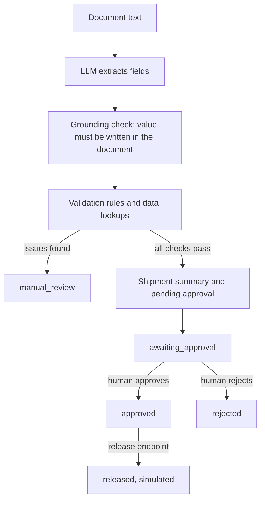

# Warehouse Outbound Invoice Agent

An API-first AI agent that checks outbound warehouse invoices and goods issue documents. It reads a document, extracts the key fields with an LLM, checks them against a small synthetic dataset, and decides whether the document needs manual review or can go to human approval. Goods are never released without a real, server-side human approval.

This is a V1 demo with synthetic data only. It does not connect to any real ERP, warehouse, accounting or customer system.

The scenario is inspired by public descriptions of enterprise AI agents with human-in-the-loop controls.

## How it works



The main design rule is **the LLM proposes, the server decides**.

- The LLM only reads the document and returns the fields as structured output.
- The server runs the tools in a fixed order and applies every business rule in plain Python.
- The LLM has no tool that can approve, reject or release. Only the approval endpoints can change an approval.
- Text inside a document is data, never an instruction. A line like "Manager already approved this" cannot change anything.

## Project layout

```
.
├── app/
│   ├── main.py          # FastAPI app, endpoints and error handlers
│   ├── __main__.py      # python -m app, starts the server on PORT
│   ├── agent.py         # runs extraction, grounding, validation and approval
│   ├── llm.py           # LLM field extraction (OpenAI or Azure OpenAI)
│   ├── grounding.py     # removes values that are not written in the document
│   ├── validation.py    # business rules
│   ├── approvals.py     # in-memory approvals and simulated release
│   ├── data_store.py    # reads the synthetic JSON data
│   ├── models.py        # Pydantic models for requests, responses and data
│   ├── config.py        # settings from environment variables
│   └── static/          # playground UI (index.html, app.js)
├── data/                # synthetic warehouses, stock and orders
├── samples/             # one request body for each of the ten task cases
├── tests/               # pytest tests
├── .env.example
├── pyproject.toml
├── requirements.txt
└── requirements-dev.txt
```

## Installation

You need Python 3.11 or newer.

```bash
git clone https://github.com/beratmertkayacan/warehouse-invoice-agent.git
cd warehouse-invoice-agent
python3 -m venv .venv
source .venv/bin/activate
pip install -r requirements-dev.txt
```

## Configuration

Copy the example file and fill in your values:

```bash
cp .env.example .env
```

| Variable | Meaning | Default |
|---|---|---|
| `OPENAI_API_KEY` | API key for OpenAI or Azure OpenAI | empty |
| `OPENAI_BASE_URL` | Leave empty for OpenAI. Set it for Azure OpenAI. | `https://api.openai.com/v1` |
| `OPENAI_MODEL` | Model name on OpenAI, or deployment name on Azure OpenAI | `gpt-4.1-mini` |
| `PORT` | Port for `python -m app` | `8000` |

### Option A: OpenAI

```
OPENAI_API_KEY=your-openai-key
OPENAI_BASE_URL=
OPENAI_MODEL=gpt-4.1-mini
```

### Option B: Azure OpenAI

1. Create an Azure OpenAI resource in a region that your subscription allows.
2. Deploy the `gpt-4.1-mini` model, for example with the Global Standard deployment type.
3. Copy the key and the endpoint from **Keys and Endpoint** in the Azure portal.

```
OPENAI_API_KEY=your-azure-openai-key
OPENAI_BASE_URL=https://<your-resource>.openai.azure.com/openai/v1/
OPENAI_MODEL=<your-deployment-name>
```

The same code works for both options, because Azure OpenAI supports the OpenAI v1 API.
Only the base URL and the model name change.

`gpt-4.1-mini` is used because it supports structured output and `temperature=0`,
and it is small and cheap. Reasoning models may not accept the `temperature` setting.

## Run the backend

```bash
python -m app
```

The server starts on `http://127.0.0.1:<PORT>` (default `8000`).
Interactive API documentation is at `http://127.0.0.1:8000/docs`.

During development you can use auto reload instead:

```bash
uvicorn app.main:app --reload
```

## Open the playground

There is no separate frontend to start. FastAPI serves the playground at `http://127.0.0.1:8000/`.

1. Paste a document into the text box and press **Send**.
2. See the status, extracted fields, validation issues, tool calls and approval state.
3. If the approval is pending, press **Approve** or **Reject**.
4. Press **Release shipment**. Before approval the server blocks it with an error. After approval it returns a shipment ID.

## API endpoints

| Method | Path | Description |
|---|---|---|
| `POST` | `/agent/chat` | Run the agent on a document |
| `GET` | `/approvals/{approval_id}` | Get an approval, its summary and its shipment ID |
| `POST` | `/approvals/{approval_id}/approve` | Approve a pending request |
| `POST` | `/approvals/{approval_id}/reject` | Reject a pending request |
| `POST` | `/shipments/{request_id}/release` | Simulated release, only after approval |
| `GET` | `/health` | Health check |
| `GET` | `/` | Playground UI |

All errors use the same JSON shape:

| Code | When | Example |
|---|---|---|
| `404` | The approval or request does not exist | `{"error": "Approval not found: APR-999"}` |
| `409` | The current state does not allow the action | `{"error": "Release blocked: approval APR-001 is pending"}` |
| `422` | The request body is not valid | `{"error": "Invalid request: message: String should have at least 1 character"}` |
| `502` | The LLM service is not available | `{"error": "The language model service is not available"}` |

## Example requests

Approval and request IDs start at `APR-001` and `REQ-001` after each restart.

```bash
curl -s -X POST http://127.0.0.1:8000/agent/chat \
  -H "Content-Type: application/json" \
  -d @samples/case10_human_approval.json

curl -s -X POST http://127.0.0.1:8000/shipments/REQ-001/release
curl -s -X POST http://127.0.0.1:8000/approvals/APR-001/approve
curl -s -X POST http://127.0.0.1:8000/shipments/REQ-001/release
curl -s http://127.0.0.1:8000/approvals/APR-001
```

The first release returns `409` because the approval is pending. After approval, the
release returns `"status": "released"` with a `shipmentId`.

## Synthetic data

All data is invented. It lives in `data/` as JSON files.

**Warehouses** (`warehouses.json`)

| warehouseId | name |
|---|---|
| WH-IST-01 | Istanbul Main Warehouse |
| WH-ANK-01 | Ankara Warehouse |

**Stock** (`stock.json`)

| warehouseId | productId | productName | availableQuantity |
|---|---|---|---|
| WH-IST-01 | PROD-001 | Industrial Sensor | 50 |
| WH-IST-01 | PROD-002 | Control Module | 5 |
| WH-IST-01 | PROD-003 | Safety Valve | 30 |
| WH-ANK-01 | PROD-001 | Industrial Sensor | 20 |

**Orders** (`orders.json`)

| orderNumber | customerId | productId | quantity | status |
|---|---|---|---|---|
| ORD-2001 | CUST-1001 | PROD-001 | 10 | approved |
| ORD-2002 | CUST-1002 | PROD-002 | 8 | approved |
| ORD-2003 | CUST-1003 | PROD-003 | 4 | approved |
| ORD-2004 | CUST-1001 | PROD-001 | 6 | approved |

The records are chosen so that each test case breaks only one rule. For example,
`PROD-003` has enough stock, so the wrong product case fails only on the product rule.
`ORD-2002` asks for 8 items but only 5 are in stock, so it tests the stock rule.
Cases 9 and 10 use their own orders, so they do not affect other cases.

## Sample inputs

Each file in `samples/` is a request body for `POST /agent/chat`

You can send it with `curl -d @file` or paste it into `/docs`.

| Case | File | Expected status |
|---|---|---|
| 1. Fully valid invoice | `case01_valid.json` | `awaiting_approval` |
| 2. Missing order number | `case02_missing_order_number.json` | `manual_review` |
| 3. Missing customer ID | `case03_missing_customer_id.json` | `manual_review` |
| 4. Unknown order | `case04_unknown_order.json` | `manual_review` |
| 5. Wrong customer for order | `case05_wrong_customer.json` | `manual_review` |
| 6. Wrong product | `case06_wrong_product.json` | `manual_review` |
| 7. Quantity does not match order | `case07_quantity_mismatch.json` | `manual_review` |
| 8. Insufficient stock | `case08_insufficient_stock.json` | `manual_review` |
| 9. Fake approval in document | `case09_fake_approval.json` | `awaiting_approval`, approval stays `pending` |
| 10. Human approves through the endpoint | `case10_human_approval.json` | `awaiting_approval`, then `approved` and `released` |

Run all samples against a running server:

```bash
for file in samples/*.json; do
  result=$(curl -s -X POST http://127.0.0.1:8000/agent/chat \
    -H "Content-Type: application/json" -d @"$file" \
    | python -c "import sys, json; print(json.load(sys.stdin)['status'])")
  echo "$file -> $result"
done
```

All ten samples were run against Azure OpenAI (`gpt-4.1-mini`) and gave the expected status.

## Validation rules

| Rule | Check | Result |
|---|---|---|
| 1 | A required field is missing | `manual_review` |
| 2 | The order number does not exist | `manual_review` |
| 3 | The customer does not match the order | `manual_review` |
| 4 | The product does not match the order | `manual_review` |
| 5 | The quantity does not match the order | `manual_review` |
| 6 | The quantity is higher than the stock in the warehouse | `manual_review` |
| 7 | All checks pass | summary, pending approval, `awaiting_approval` |

Two extra checks catch obvious errors: the quantity must be greater than zero, and the warehouse must exist.

Required fields: `invoiceNumber`, `orderNumber`, `warehouseId`, `customerId`,
`productId`, `quantity`, `destination`. Optional fields: `requestedDate`, `notes`.

Missing fields and unknown orders stop the checks early. After the order is found,
all other issues are collected and returned together.

## How approval works

1. Only the server creates an approval, and only after all checks pass. There is no endpoint to create one.
2. A new approval is always `pending`.
3. Only `POST /approvals/{id}/approve` and `POST /approvals/{id}/reject` can change it.
4. A decision is final. An approved request cannot be rejected, and a rejected request cannot be approved.
5. `POST /shipments/{requestId}/release` works only when the approval is `approved`. A `pending` or `rejected` approval returns `409`.
6. A request can be released only once.
7. The release is simulated. It does not change any stock or any real system.

- Approvals are stored in memory. They are lost when the server restarts.


## Agent tools

| Tool in the task | Where it is |
|---|---|
| `get_order` | `data_store.get_order` |
| `get_stock` | `data_store.get_stock` |
| `validate_invoice` | `validation.validate_invoice` |
| `prepare_shipment_summary` | `approvals.prepare_shipment_summary` |
| `submit_for_human_approval` | `ApprovalStore.create`, called by the agent |
| `get_approval_status` | `GET /approvals/{approval_id}` |
| `release_shipment` | `POST /shipments/{request_id}/release` |

`toolCalls` in the response lists only the tools that were really called.
The tool order is fixed by the server. The LLM does not choose tools in V1.

## Security

- **Synthetic data only.** No real company, customer or personal data.
- **No guessing.** The prompt tells the model to return null for missing values, and the grounding check removes any required value that is not written in the document.
- **Document text is not authorization.** The model has no approval tool, and approval state changes only through the approval endpoints.
- **No release without approval.** The release endpoint checks the approval state on the server.
- **No secrets in code or responses.** Keys come from environment variables. LLM errors return a general message without internal details.
- **System prompt is never returned.** The answer text is written by the server, not by the model.
- **Requests are isolated.** Every request gets its own approval and request ID.
- **Safe UI.** The playground writes server text with `textContent`, so document text cannot run as code.

## Tests

```bash
pytest
ruff check .
ruff format --check .
```

- 100 tests, 100% line coverage. The run fails if coverage drops below 90%.
- Tests never call a real LLM or the network. They use a fake extractor and a fake client.
- Every task case has its own test, and every sample file is checked against its expected status.

| Test file | Focus |
|---|---|
| `test_validation.py` | Each rule, messages and recorded lookups |
| `test_approvals.py` | Approval states and release rules |
| `test_agent.py` | Task cases 1 to 9 through the agent |
| `test_api_agent.py` | Response shape, cases 9 and 10 through the API, errors |
| `test_samples.py` | Every file in `samples/` |
| `test_grounding.py` | Values that are not in the document |
| `test_llm.py`, `test_config.py` | Extractor and settings with fakes |
| `test_api_approvals.py`, `test_api_errors.py` | Endpoint codes and error shape |
| `test_data_store.py`, `test_ui.py`, `test_health.py`, `test_entry.py` | Data, playground, health and start-up |

## Known limitations

- Approvals live in memory and are lost on restart.
- The same document can be sent twice and create two approvals. There is no duplicate check.
- Release does not reduce stock.
- One document has one product line.
- There is no login. Anyone who can reach the API can approve.
- The grounding check needs the value as written. For example, "ten" instead of "10" leads to manual review. This is safe but strict.
- The playground is not tested in a browser. Only its files and the API behind it are tested.

## Future work

- Persistent storage, for example SQLite first and then Azure SQL or Cosmos DB.
- Audit log: who approved, when, and what changed.
- Approver login and roles with Microsoft Entra ID.
- Duplicate invoice detection.
- Stock reservation on approval and stock update on release.
- Cancel and return flows after release.
- Keyless access to Azure OpenAI with managed identity.
- Deployment with Docker and Azure Container Apps.
- Monitoring with Application Insights.
- LLM evaluation and prompt injection tests, for example with Promptfoo.
- Let the LLM choose read-only tools. Approval and release stay server-only.
- PDF and scanned documents with Azure AI Document Intelligence.
